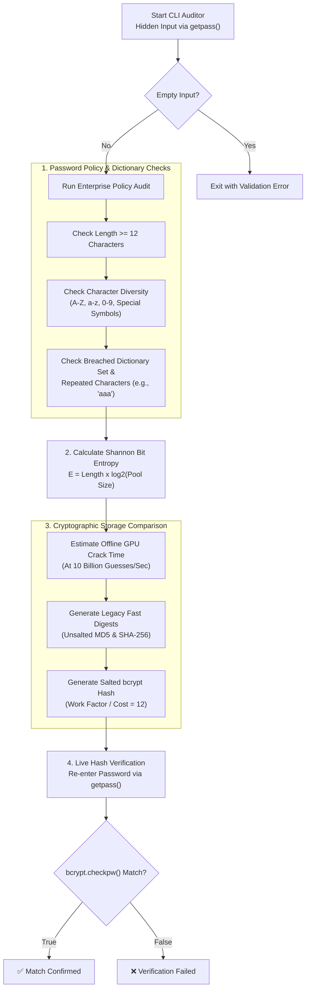
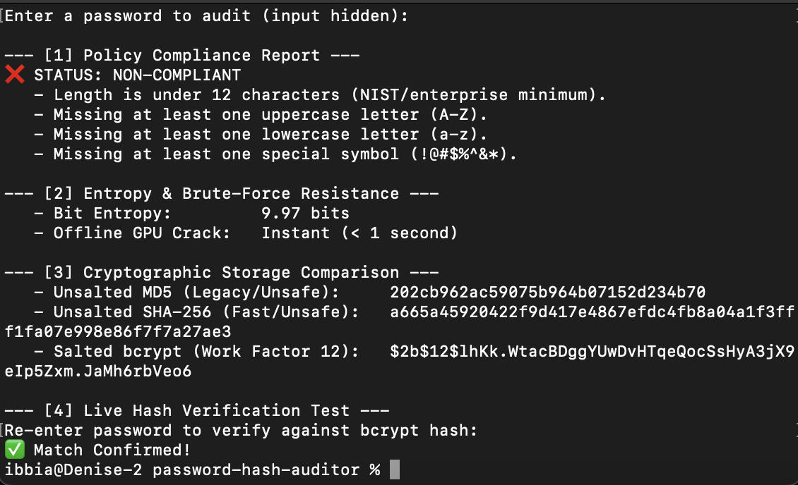
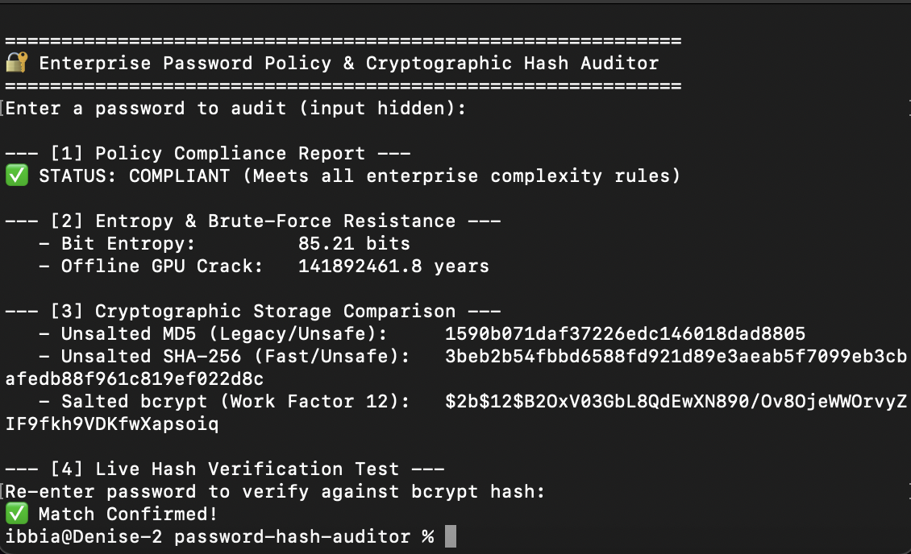

#  Enterprise Password Policy & Cryptographic Hash Auditor

A Python command-line security tool designed to audit password strength against enterprise compliance policies, calculate bit entropy and offline GPU brute-force crack times, and demonstrate secure cryptographic storage using salted `bcrypt` hashing.

Built to explore applied cryptography, authentication security, and defensive remediation against credential-dumping attacks.

---

##  Audit & Cryptographic Verification Flowchart



---

##  Security Concepts Demonstrated

### 1. Password Entropy & Brute-Force Resistance
* **Bit Entropy (`E = L × log₂(R)`):** Evaluates unpredictability based on password length (`L`) and character pool size (`R`, up to 94 printable ASCII characters). Every additional bit doubles the keyspace an attacker must search.
* **Offline GPU Modeling:** Translates raw bit entropy into practical crack-time estimates assuming an offline GPU cluster testing $10^{10}$ (10 billion) guesses per second.

### 2. Why Legacy Hashes Fail vs. `bcrypt`

| Algorithm | Speed | Built-In Salt? | Security Assessment |
| :--- | :--- | :--- | :--- |
| **MD5 / SHA-256** | Extremely Fast | ❌ No | **Unsafe for passwords.** Vulnerable to precomputed Rainbow Tables and high-speed GPU brute-force cracking. |
| **`bcrypt` (Cost 12)** | Intentionally Slow | ✅ Yes | **Recommended.** Unique random salts defeat Rainbow Tables, while key stretching ($2^{12}$ iterations) throttles brute-force attacks. |

### 3. Operational Security (`getpass`)
* Uses Python's `getpass` module so sensitive test inputs are never echoed to the terminal screen or saved in shell history logs.

---

##  Setup & Usage

### 1. Install Dependencies
```bash
git clone https://github.com<YOUR-USERNAME>/password-hash-auditor.git
cd password-hash-auditor
pip3 install -r requirements.txt
```

### 2. Run the Auditor
```bash
python3 auditor.py
```

---

##  Sample Audit Output

### 1. Weak / Non-Compliant Password Audit (`admin123`) & `bcrypt` Verification


### 2. Strong / Compliant Password Audit & `bcrypt` Verification

